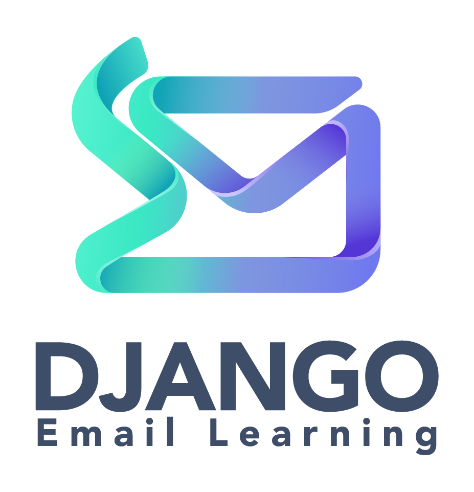

<p align="center">
  
</p>

<p align="center">
  <a href="https://opensource.org/licenses/BSD-3-Clause"></a>
  <a href="https://www.python.org/downloads/"></a>
  <a href="https://www.djangoproject.com/"></a>
  
</p>

# Django Email Learning

**Build email-based learning platforms with Django.**

Django Email Learning is an open-source Django application that provides the foundation for building email-based learning platforms. Create courses, schedule lessons, deliver quizzes, track learner progress, and issue verifiable completion certificates — all through an email-first learning experience.

Whether you're building an educational platform, an internal training system, or a specialized learning solution, Django Email Learning gives you a foundation to build upon.

**Try it:** [Inbox Academy](https://inboxacademy.io) is a hosted learning platform built on Django Email Learning. Start a trial and experience an email-based course firsthand.

**Documentation:** [django-email-learning.readthedocs.io](https://django-email-learning.readthedocs.io)

**Installation:** `pip install django-email-learning`

---

## Why email-based learning?

Traditional e-learning platforms often require learners to visit a website, log into an account, or install an application to access their learning materials.

Email-based learning takes a different approach: deliver learning experiences through a channel people already use.

- **Low bandwidth:** Text-based lessons require very little data and work well with slow or unstable internet connections.
- **No additional app or account:** Learners receive lessons directly in their inbox without needing another platform login.
- **Accessible across devices:** Email works on virtually any device with an email client.
- **Resilience in restricted environments:** Email can provide an alternative learning channel in environments where access to websites and other platforms is limited.
- **Learning at your own pace:** Scheduled delivery helps learners progress through structured learning journeys without having to remember to visit a platform.

## What can you build?

Django Email Learning provides the core components for building an email-based learning platform.

- **Courses and lessons:** Organize educational content into structured courses and learning journeys.
- **Automated content delivery:** Schedule lessons and quizzes based on configurable timing rules.
- **Quizzes and assessments:** Deliver quizzes and collect learner responses.
- **Progress tracking:** Track learner progress and automate transitions between course steps.
- **Completion certificates:** Generate online certificates with QR codes for verification.
- **Newsletters:** Manage organization-specific subscriber lists and schedule email campaigns.
- **IMAP integration:** Integrate email-based interactions with the platform.
- **API and automation:** Trigger platform operations through API endpoints and Django management commands.
- **Frontend components:** Use the included React components to build platform interfaces.

## Sponsorship

Django Email Learning is an open-source project maintained by AvaCode Solutions.

Maintaining an open-source platform takes time and resources. Your sponsorship helps us continue improving the project, maintaining its documentation, and making email-based learning technology accessible to more developers and organizations.

We welcome support from individuals and companies interested in the future of open-source educational technology.

Depending on your sponsorship tier, we offer:
- Recognition on the project README and documentation.
- Company logo and website placement.
- Visibility in project updates.

**[Become a sponsor on GitHub](https://github.com/sponsors/AvaCodeSolutions)**

Every contribution helps keep the project moving forward.


## Need Help?

Building a platform with Django Email Learning? If you need help with implementation, customization, or integration, [get in touch with AvaCode Solutions](https://avacodesolutions.com).

We'd be happy to discuss your project.

## Documentation

Comprehensive documentation is available at [django-email-learning.readthedocs.io](https://django-email-learning.readthedocs.io), covering:

- **Installation Guide:** Set up a new project or integrate the package into an existing Django application.
- **Platform Management:** Create organizations, courses, and manage learners.
- **Technical Reference:** Explore management commands, API endpoints, and configuration.
- **Usage Examples:** Learn how to configure and operate the platform.

## Installation

### Quick Start

The fastest way to get a working development environment is the interactive setup command:

```bash
pip install django-email-learning
django-email-learning-init
```

This sets up a new Django project with `django_email_learning` pre-configured, including a virtual environment, secrets, migrations, and a superuser.

See the [Installation Guide](https://django-email-learning.readthedocs.io/en/latest/installation.html) for the full walkthrough.

### Manual Installation

For existing Django projects, follow these steps.

#### 1. Install the Package

```bash
pip install django-email-learning
```

#### 2. Add to INSTALLED_APPS

Add `django_email_learning` to your `INSTALLED_APPS` in the Django settings file:

```python
INSTALLED_APPS = [
    ...
    'django_email_learning',
]
```

#### 3. Configure Settings

Add the required configuration for the site base URL in your Django settings:

```python
DJANGO_EMAIL_LEARNING = {
    "SITE_BASE_URL": "<YOUR_SITE_BASE_URL_STARTING_WITH_HTTP>",
    "ENCRYPTION_SECRET_KEY": "<LONG_RANDOM_STRING>",
    "JWT_SECRET_KEY": "<LONG_RANDOM_STRING>",
}
```

`ENCRYPTION_SECRET_KEY` should be a long random string used to protect sensitive values such as stored API keys.

#### 4. Configure Media Files

This app uses Django's MEDIA files to save organization logos. Ensure your media settings are configured correctly. See the [MEDIA_URL setting](https://docs.djangoproject.com/en/6.0/ref/settings/#media-url) for details.

#### 5. Run Migrations

```bash
python manage.py migrate
```

#### 6. Add URLs

Include the app URLs in your main Django URLs configuration:

```python
from django.urls import path, include
from django_email_learning import urls as email_learning_urls

urlpatterns = [
    ...
    path(
        'your_preferred_path/',
        include(email_learning_urls, namespace='django_email_learning')
    ),
]
```

The platform will be accessible at `your_preferred_path/platform/`.

#### Access Control Notes

You need to be logged in to access the `/platform` sub-URL, which is used for managing courses and viewing learner progress.

## Usage

### Newsletters

Django Email Learning includes a built-in newsletter system. Platform admins can create newsletters per organization, grow a subscriber list, and schedule email campaigns (sendouts) that are delivered automatically.

See the [Newsletter documentation](https://django-email-learning.readthedocs.io/en/latest/platform/newsletters.html) for configuration and usage details.

#### Optional: Auto-subscribe on Course Enrollment

Link a newsletter to a course in the platform UI or through the API. When a learner enrolls in that course, they are automatically subscribed to the linked newsletter. Learners can opt out by unchecking the subscription checkbox during enrollment.

### Content Delivery

The app uses the email backend defined in Django settings to deliver course content.

Assuming you have active courses and enrollments, schedule a job that runs the content delivery management command periodically (e.g., using cron or a cloud scheduler).

Execute the content delivery job using:

```bash
python manage.py deliver_contents
```

You can also trigger this job via API, which is useful when running from an external scheduler:

```http
GET /your_preferred_path/api/jobs/deliver_contents/
Authorization: Bearer <API_KEY>
```

This endpoint requires an API key. You can generate and manage API keys from Platform Settings > API Keys in the platform UI.

## Contributing

Contributions are welcome!

Whether you're fixing bugs, improving documentation, suggesting features, or contributing code, we'd love to hear from you.

Please read our [Contributing Guide](https://github.com/AvaCodeSolutions/django-email-learning/blob/master/CONTRIBUTING.md) to learn about our development process, development environment, and how to submit pull requests.

## License

This project is licensed under the BSD 3-Clause License. See the [LICENSE](https://github.com/AvaCodeSolutions/django-email-learning/blob/master/LICENSE) file for details.
